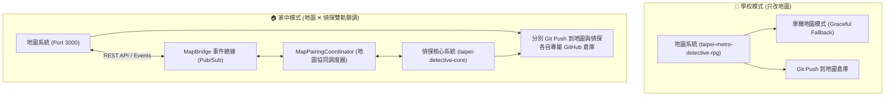

# 🗺️ 雙北都會行蹤：地圖 ✕ 偵探系統搭配協同手冊 (Map-Detective Pairing Guide)

> **適用情境**：
> - 🏫 **在學校時**：只改地圖系統 (`taipei-metro-detective-rpg` 或鏡像)。地圖系統保持獨立運作、免依賴偵探核心。
> - 🏠 **回到家時**：同時改動與測試偵探系統 (`taipei-detective-core`) 與地圖系統，雙軌實機即時聯調。

---

## 🧭 1. 學校 vs 家中 開發流程架構

---

## 🛠️ 2. 偵探系統的地圖搭配模組 (`MapPairingCoordinator`)

偵探核心中專門負責與地圖搭配的核心類別為：
📂 [`src/bridge/MapPairingCoordinator.js`](file:///Users/home/crew-deck-role/ai-engineer/taipei-detective-core/src/bridge/MapPairingCoordinator.js)

### 核心功能矩陣：

1. **案發搜查警戒圈管理 (Crime Scene Perimeters)**：
   - 為企劃書 10 大示範案件配置精確的真實雙北 GPS 中心點與半徑 (50~150m)：
     - `case_01` 西門町拿鐵咖啡案：半徑 80m（萬華西門商圈）
     - `case_02` 台北車站水力延時案：半徑 120m（中正核心樞紐）
     - `case_03` 淡水碼頭航海磚案：半徑 150m（老街紅磚倉庫）
     - `case_04` 北投溫泉空白遺書案：半徑 90m（溫泉博物館街區）
     - `case_05` 板橋林家花園日影案：半徑 110m（方鑑齋園邸）
     - `case_06` 西門超商冷藏指紋案：半徑 60m
     - `case_07` 板南線急煞調包案：半徑 100m
     - `case_08` 大稻埕中藥鋪案：半徑 85m
     - `case_09` 307 公車急煞案：半徑 130m
     - `case_10` 大安森林泥地案：半徑 140m
2. **空間定位與防瞬移感測 (`syncLocationFromMap`)**：
   - 接收地圖傳來的經緯度，以 Haversine 大圓公式精算真實距離。
   - 步行每 80 公尺消耗 1 點體力；單次位移超過 2,500 公尺未搭車時，觸發憲法級防瞬移攔截（回傳 403 禁令）。
   - 當調查員踏入搜查半徑內，自動標記 `enteredCrimeScene: true`，解鎖物證勘查與筆錄詢問。
3. **GeoJSON 格式匯出 (`exportGeoJson`)**：
   - 將案件中心點、涉案關係人、關鍵物證與調查員實體位置封裝為標準 GeoJSON FeatureCollection，可直接餵給 Leaflet 或 Canvas 沙盤。
4. **大眾運輸與 TPASS 1200 聯動**：
   - 搭乘雙北捷運或公車時自動查驗 TPASS 1200 悠遊卡通勤月票，享有雙北官方同款 $0 扣款與轉乘優惠。

---

## 🌐 3. 雙軌 API 端點規格

| 端點 (Method & URL) | 說明 | 回傳範例 |
| :--- | :--- | :--- |
| `GET /api/detective/map/pairing-status` | 取得當前案件警戒圈、涉案關係人點位、物證標記與調查員實體距離 | `{ success: true, perimeter: { radiusMeters: 80, ... } }` |
| `GET /api/detective/map/geojson` | 匯出標準 GeoJSON 圖層資料供地圖無縫繪製 | `{ type: "FeatureCollection", features: [...] }` |
| `POST /api/detective/map/sync-location` | 接收地圖 GPS 座標同步，即時判定警戒圈與體力扣減 | `{ success: true, enteredCrimeScene: true }` |
| `POST /api/detective/map/mode` | 切換學校獨立模式 (`school`) 或家中雙軌聯調模式 (`home`) | `{ success: true, mode: "home" }` |
| `GET /api/detective/bridge/events` | 取得地圖 ⇄ 偵探雙向協同事件日誌 | `{ success: true, events: [...] }` |

---

## 🎮 4. 實機操作方式

1. **家中模式（雙軌聯調）**：
   - 終端執行：`cd taipei-metro-detective-rpg && node server.js`
   - 瀏覽器開啟地圖：[http://localhost:3000](http://localhost:3000)
   - 點擊頂部 **「🕵️ 都會調查員・偵探核心」** 按鈕或開啟 [http://localhost:3000/detective](http://localhost:3000/detective)
   - 工作台內建動態情勢雷達，可視覺化即時監控調查員接近案發現場！
2. **學校模式（單獨改地圖）**：
   - 在學校環境只開啟地圖專案，執行 `node server.js`，地圖系統自動容錯 fallback，不報錯不崩潰。
   - 回到家後，兩端分別提交 Git Commit，無衝突、無縫同步！
